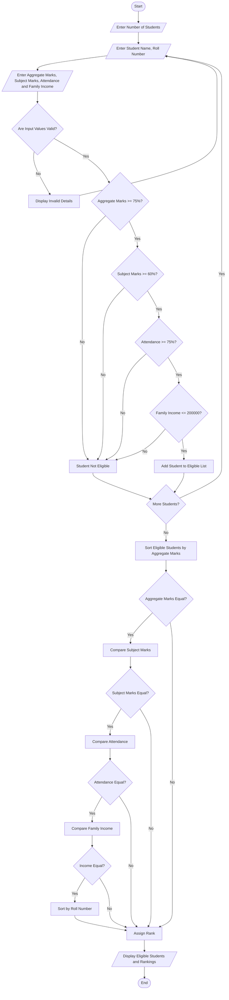

# University Scholarship Allocation System

students = []

n = int(input("Enter number of students: "))

for i in range(n):
    print("\nEnter details of Student", i + 1)

    name = input("Enter student name: ")
    roll = input("Enter roll number: ")
    marks = float(input("Enter aggregate marks: "))
    subject = float(input("Enter minimum subject marks: "))
    attendance = float(input("Enter attendance percentage: "))
    income = float(input("Enter annual family income: "))

    # Eligibility checking
    if (marks >= 75 and subject >= 60 and
        attendance >= 75 and income <= 200000):

        students.append({
            "name": name,
            "roll": roll,
            "marks": marks,
            "subject": subject,
            "attendance": attendance,
            "income": income
        })

# Ranking eligible students
students.sort(
    key=lambda x: (
        -x["marks"],
        -x["subject"],
        -x["attendance"],
        x["income"],
        x["roll"]
    )
)

print("\n===== SCHOLARSHIP ALLOCATION RESULTS =====")

if len(students) == 0:
    print("No eligible students found.")

else:
    for rank, student in enumerate(students, start=1):
        print("\nRank:", rank)
        print("Name:", student["name"])
        print("Roll Number:", student["roll"])
        print("Aggregate Marks:", student["marks"])
        print("Subject Marks:", student["subject"])
        print("Attendance:", student["attendance"])
        print("Family Income:", student["income"])
print("\nTotal Eligible Students:", len(students))

Algorithm:
University Scholarship Allocation
Step 1: Start the program.

Step 2: Read the number of students.

Step 3: Enter the details of each student:
- Student name
- Roll number
- Aggregate marks
- Subject-wise marks
- Attendance percentage
- Family annual income
Step 4: Check whether the entered details are valid.

Step 5: Check the eligibility criteria:
- Aggregate marks must be 75% or above.
- Subject-wise marks must be 60% or above.
- Attendance must be 75% or above.
- Family annual income must be ₹2,00,000 or below.
Step 6: If all conditions are satisfied, add the student to the eligible students list. Otherwise, mark the student as not eligible.

Step 7: Repeat Steps 3–6 until all student details are entered.

Step 8: Sort the eligible students in descending order based on aggregate marks.

Step 9: Resolve ties using the following rules:
1. Higher aggregate marks get higher priority.
2. If aggregate marks are equal, compare subject-wise marks.
3. If subject marks are equal, compare attendance percentage.
4. If attendance is equal, give priority to the student with lower family income.
5. If all values are equal, sort by roll number in ascending order.
Step 10: Assign ranks to all eligible students.

Step 11: Display the eligible students with their details and rankings.

Step 12: Stop the program.

