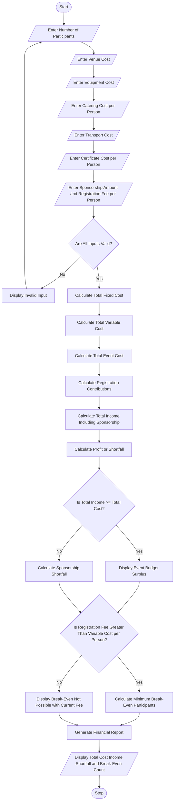

# Campus Event Financial Planning System

print("===== CAMPUS EVENT FINANCIAL PLANNING =====")

# Get event details
event_name = input("Enter event name: ")

participants = int(input("Enter expected number of participants: "))

# Get event expenses
venue = float(input("Enter venue cost: Rs. "))
equipment = float(input("Enter equipment cost: Rs. "))
catering = float(input("Enter catering cost per participant: Rs. "))
transport = float(input("Enter transport cost: Rs. "))
certificate = float(input("Enter certificate cost per participant: Rs. "))

# Get financial support
sponsorship = float(input("Enter sponsorship amount: Rs. "))
registration_fee = float(input("Enter registration fee per participant: Rs. "))

# Validate inputs
if (participants <= 0 or venue < 0 or equipment < 0 or
    catering < 0 or transport < 0 or certificate < 0 or
    sponsorship < 0 or registration_fee < 0):

    print("Invalid event details!")

else:
    # Calculate total expenses
    fixed_cost = venue + equipment + transport

    variable_cost = (catering + certificate) * participants

    total_cost = fixed_cost + variable_cost

    # Calculate participant contributions
    contribution = registration_fee * participants

    # Calculate sponsorship shortfall
    total_income = contribution + sponsorship

    shortfall = max(0, total_cost - total_income)

    # Calculate break-even registration count
    if registration_fee > (catering + certificate):
        required = (fixed_cost - sponsorship) / (
            registration_fee - catering - certificate
        )

        break_even = max(0, int(required) if required == int(required)
                         else int(required) + 1)

    else:
        break_even = None

    # Display financial report
    print("\n===== EVENT FINANCIAL REPORT =====")

    print("Event Name:", event_name)
    print("Expected Participants:", participants)

    print("\n----- EXPENSE DETAILS -----")
    print("Venue Cost: Rs.", venue)
    print("Equipment Cost: Rs.", equipment)
    print("Catering Cost: Rs.", catering * participants)
    print("Transport Cost: Rs.", transport)
    print("Certificate Cost: Rs.", certificate * participants)

    print("--------------------------------")
    print("Total Event Cost: Rs.", total_cost)

    print("\n----- INCOME DETAILS -----")
    print("Registration Contributions: Rs.", contribution)
    print("Sponsorship Amount: Rs.", sponsorship)
    print("Total Income: Rs.", total_income)

    print("Sponsorship/Financial Shortfall: Rs.", shortfall)

    print("\n----- BREAK-EVEN ANALYSIS -----")

    if break_even is not None:
        print("Minimum Registrations Required:", break_even)
    else:
        print("Break-even cannot be achieved with this fee.")

    if total_income >= total_cost:
        print("Event Financial Status: Budget Achieved")
    else:
        print("Event Financial Status: Budget Shortfall")
        Start the program.

Read the number of students.

Enter each student's name, roll number, aggregate marks, subject-wise marks, attendance, and family income.

Validate the entered details.

Check the eligibility conditions:
- Aggregate marks must be at least 75%.
- Subject-wise marks must be at least 60%.
- Attendance must be at least 75%.
- Family annual income must not exceed ₹2,00,000.

If all conditions are satisfied, add the student to the eligible list.

Otherwise, mark the student as not eligible.

Repeat the process for all students.

Sort eligible students by aggregate marks in descending order.

Resolve ties using:
- Higher subject-wise marks.
- Higher attendance.
- Lower family income.
- Lower roll number.

Assign ranks to eligible students.

Display eligible students and their rank
stop the progrem

BEGIN

INPUT number_of_students

CREATE eligible_list

FOR each student

    INPUT name, roll_number
    INPUT aggregate_marks
    INPUT subject_marks
    INPUT attendance
    INPUT family_income

    IF aggregate_marks >= 75 AND
       subject_marks >= 60 AND
       attendance >= 75 AND
       family_income <= 200000 THEN

        ADD student to eligible_list

    ELSE
        DISPLAY "Not Eligible"
    END IF

END FOR

SORT eligible_list BY
    aggregate_marks DESCENDING
    subject_marks DESCENDING
    attendance DESCENDING
    family_income ASCENDING
    roll_number ASCENDING

ASSIGN ranks to eligible students

DISPLAY eligible students with ranks

END
========== UNIVERSITY SCHOLARSHIP ALLOCATION ==========

Eligible Students:

Rank  Name      Roll No   Aggregate   Subject   Attendance   Income
--------------------------------------------------------------------
1     Priya     104       90%         85%       92%          120000
2     Veda      102       90%         80%       95%          180000
3     Harika    101       85%         75%       90%          150000

Not Eligible Students:
Nomitha - Aggregate marks below 75%

Total Students: 4
Eligible Students: 3
Not Eligible Students: 1

Scholarship Allocation Completed Successfully!
The University Scholarship Allocation system evaluates students based on aggregate marks, subject-wise marks, attendance, and family income. It identifies eligible students and ranks them according to their performance. It also resolves ties using predefined rules, ensuring fair and transparent scholarship selection.
