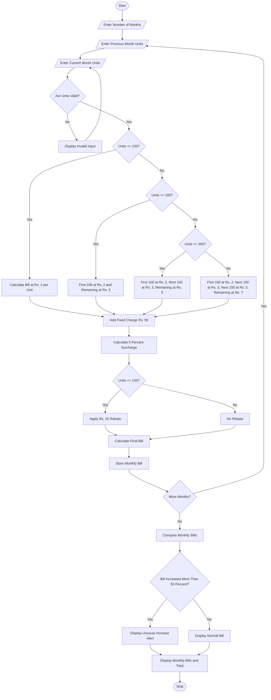

# Progressive Electricity Billing System

months = int(input("Enter number of months: "))

bills = []

for i in range(months):
    print("\nMonth", i + 1)

    month = input("Enter month name: ")
    units = float(input("Enter electricity units consumed: "))

    # Calculate electricity charges using slabs
    if units <= 100:
        bill = units * 2
    elif units <= 200:
        bill = (100 * 2) + (units - 100) * 3
    elif units <= 300:
        bill = (100 * 2) + (100 * 3) + (units - 200) * 5
    else:
        bill = (100 * 2) + (100 * 3) + (100 * 5) + (units - 300) * 7

    # Fixed charge
    fixed_charge = 50

    # Surcharge
    surcharge = bill * 0.05

    # Rebate for low consumption
    rebate = 20 if units <= 100 else 0

    # Final bill
    total = bill + fixed_charge + surcharge - rebate

    bills.append({
        "month": month,
        "units": units,
        "amount": total
    })

    print("Energy Charge: Rs.", round(bill, 2))
    print("Fixed Charge: Rs.", fixed_charge)
    print("Surcharge: Rs.", round(surcharge, 2))
    print("Rebate: Rs.", rebate)
    print("Total Bill: Rs.", round(total, 2))

# Monthly bill comparison
print("\n===== MONTHLY BILL COMPARISON =====")

for i in range(len(bills)):
    print(bills[i]["month"], ":", round(bills[i]["amount"], 2))

# Identify unusual increases
print("\n===== UNUSUAL BILL INCREASES =====")

found = False

for i in range(1, len(bills)):
    previous = bills[i - 1]["amount"]
    current = bills[i]["amount"]

    increase = current - previous

    if increase > 0:
        percentage = (increase / previous) * 100

        if percentage > 50:
            print("Warning:", bills[i]["month"],
                  "bill increased by",
                  round(percentage, 2), "%")
            found = True

if not found:
    print("No unusual bill increases found.")
    Start the program.

Enter the number of months.

Enter the month name and electricity units consumed.

Check whether the entered units are valid.

Calculate the energy charge according to consumption slabs:
- 0–100 units: ₹2 per unit.
- 101–200 units: ₹3 per additional unit.
- 201–300 units: ₹5 per additional unit.
- Above 300 units: ₹7 per additional unit.

Add the fixed charge of ₹50.

Calculate a 5% surcharge on the energy charge.

Apply a ₹20 rebate if consumption is 100 units or less.

Calculate and display the final electricity bill.

Compare the current month's bill with the previous month's bill.

If the bill increases by more than 50%, display an unusual increase alert.

Otherwise, display a normal bill message.

Repeat the process for all months.

Stop the program.

START

INPUT number_of_months
SET previous_bill = 0

FOR each month from 1 to number_of_months

    INPUT month_name
    INPUT units_consumed

    IF units_consumed < 0
        DISPLAY "Invalid units"
        CONTINUE
    END IF

    IF units_consumed <= 100
        energy_charge = units_consumed * 2

    ELSE IF units_consumed <= 200
        energy_charge = 100 * 2 + (units_consumed - 100) * 3

    ELSE IF units_consumed <= 300
        energy_charge = 100 * 2 + 100 * 3
                        + (units_consumed - 200) * 5

    ELSE
        energy_charge = 100 * 2 + 100 * 3
                        + 100 * 5 + (units_consumed - 300) * 7
    END IF

    fixed_charge = 50
    surcharge = energy_charge * 0.05

    IF units_consumed <= 100
        rebate = 20
    ELSE
        rebate = 0
    END IF

    current_bill = energy_charge + fixed_charge
                   + surcharge - rebate

    DISPLAY current_bill

    IF previous_bill > 0
        increase = current_bill - previous_bill

        IF increase > previous_bill * 0.50
            DISPLAY "Unusual Increase Detected"
        ELSE
            DISPLAY "Normal Bill"
        END IF
    END IF

    previous_bill = current_bill

END FOR

STOP
       ELECTRICITY BILL REPORT

Month 1:
Units Consumed       : 80
Energy Charge        : Rs. 160
Fixed Charge         : Rs. 50
Surcharge (5%)       : Rs. 10.50
Rebate               : Rs. 20
Final Bill           : Rs. 200.50

Month 2:
Units Consumed       : 150
Energy Charge        : Rs. 350
Fixed Charge         : Rs. 50
Surcharge (5%)       : Rs. 20
Rebate               : Rs. 0
Final Bill           : Rs. 420

Month 3:
Units Consumed       : 250
Energy Charge        : Rs. 650
Fixed Charge         : Rs. 50
Surcharge (5%)       : Rs. 35
Rebate               : Rs. 0
Final Bill           : Rs. 735

       MONTHLY BILL COMPARISON

Month 1: Rs. 200.50
Month 2: Rs. 420.00
Month 3: Rs. 735.00

Unusual Increase Detected:
Month 2: Bill increased by more than 50%.
Month 3: Bill increased by more than 50%.

Total Electricity Bill: Rs. 1355.50
The Progressive Electricity Billing system calculates electricity bills accurately using different consumption slabs, fixed charges, surcharges, and rebates. It compares monthly bills and identifies unusual increases in electricity charges. This system helps households understand their electricity usage and manage their expenses efficiently.
