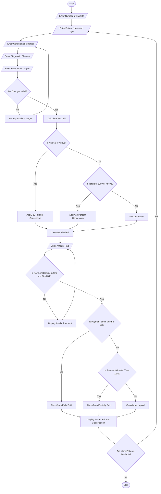

# Hospital Billing and Patient Classification

print("===== HOSPITAL BILLING SYSTEM =====")

name = input("Enter patient name: ")
age = int(input("Enter patient age: "))

# Get hospital charges
consultation = float(input("Enter consultation charges: "))
diagnostic = float(input("Enter diagnostic charges: "))
treatment = float(input("Enter treatment charges: "))

# Validate input
if age <= 0 or consultation < 0 or diagnostic < 0 or treatment < 0:
    print("Invalid input! Please enter valid details.")

else:
    # Calculate total bill
    total = consultation + diagnostic + treatment

    # Apply concessions
    if age >= 60:
        discount = total * 0.20
    elif total >= 5000:
        discount = total * 0.10
    else:
        discount = 0

    final_bill = total - discount

    print("\n===== BILL DETAILS =====")
    print("Patient Name:", name)
    print("Total Charges: Rs.", total)
    print("Concession: Rs.", discount)
    print("Final Bill: Rs.", final_bill)

    # Payment details
    paid = float(input("Enter amount paid: "))

    if paid < 0 or paid > final_bill:
        print("Invalid payment amount!")

    else:
        balance = final_bill - paid

        # Patient classification
        print("\n===== PATIENT CLASSIFICATION =====")

        if balance == 0:
            print("Fully Paid Patient")
        elif paid > 0:
            print("Partially Paid Patient")
        else:
            print("Unpaid Patient")

        print("Amount Paid: Rs.", paid)
        print("Balance: Rs.", balance)

        
