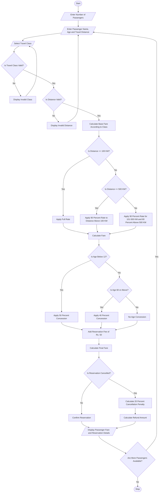

# Railway Fare and Reservation Calculator

print("===== RAILWAY RESERVATION SYSTEM =====")

n = int(input("Enter number of passengers: "))

total_fare = 0

for i in range(n):

    print("\nPassenger", i + 1)

    name = input("Enter passenger name: ")
    age = int(input("Enter passenger age: "))
    distance = float(input("Enter travel distance (KM): "))

    print("\nTravel Classes")
    print("1. Sleeper - Rs. 2 per KM")
    print("2. AC 3 Tier - Rs. 4 per KM")
    print("3. AC 2 Tier - Rs. 6 per KM")

    choice = int(input("Select travel class (1-3): "))

    # Validate details
    if age <= 0 or distance <= 0 or choice not in [1, 2, 3]:
        print("Invalid passenger details!")
        continue

    # Select class fare
    if choice == 1:
        rate = 2
        class_name = "Sleeper"
    elif choice == 2:
        rate = 4
        class_name = "AC 3 Tier"
    else:
        rate = 6
        class_name = "AC 2 Tier"

    # Distance slab calculation
    if distance <= 100:
        base_fare = distance * rate
    elif distance <= 500:
        base_fare = 100 * rate + (distance - 100) * rate * 0.9
    else:
        base_fare = (100 * rate) + (400 * rate * 0.9) + (distance - 500) * rate * 0.8

    # Age-based concession
    if age < 12:
        concession = base_fare * 0.50
    elif age >= 60:
        concession = base_fare * 0.40
    else:
        concession = 0

    # Reservation fee
    reservation_fee = 50

    final_fare = base_fare - concession + reservation_fee

    print("\n----- PASSENGER FARE DETAILS -----")
    print("Name:", name)
    print("Age:", age)
    print("Class:", class_name)
    print("Distance:", distance, "KM")
    print("Base Fare: Rs.", round(base_fare, 2))
    print("Concession: Rs.", round(concession, 2))
    print("Reservation Fee: Rs.", reservation_fee)
    print("Final Fare: Rs.", round(final_fare, 2))

    total_fare += final_fare

# Total reservation amount
print("\n===== TOTAL RESERVATION BILL =====")
print("Total Fare: Rs.", round(total_fare, 2))

# Cancellation calculation
cancel = input("\nDo you want to cancel the reservation? (yes/no): ")

if cancel.lower() == "yes":
    penalty = total_fare * 0.20
    refund = total_fare - penalty

    print("\n===== CANCELLATION DETAILS =====")
    print("Cancellation Penalty: Rs.", round(penalty, 2))
    print("Refund Amount: Rs.", round(refund, 2))
    Algorithm
1. Start the program.
2. Enter the number of passengers.
3. Enter passenger name, age, and travel distance.
4. Select the travel class (Sleeper, AC3, or AC2).
5. Calculate the base fare according to the selected class.
6. Apply the distance-based fare slabs:
   - Up to 100 km: 100% of the class rate.
   - 101–500 km: 90% of the class rate for additional distance.
   - Above 500 km: 80% of the class rate for additional distance.
7. Apply age-based concessions:
   - Below 12 years: 50% concession.
   - 60 years or above: 40% concession.
   - Other passengers: No concession.
8. Add the reservation fee of ₹50.
9. Calculate the final fare.
10. Ask whether the reservation is cancelled.
11. If cancelled, apply a 20% cancellation penalty and calculate the refund.
12. Otherwise, confirm the reservation.
13. Display passenger details, fare, and refund information.
14. Repeat for all passengers.
15. Stop the program.

START

INPUT number of passengers

FOR each passenger

    INPUT passenger name
    INPUT age
    INPUT travel distance
    INPUT travel class

    IF travel class is Sleeper THEN
        rate = 2
    ELSE IF travel class is AC3 THEN
        rate = 4
    ELSE IF travel class is AC2 THEN
        rate = 6
    ELSE
        DISPLAY "Invalid travel class"
        CONTINUE
    END IF

    IF distance <= 100 THEN
        fare = distance * rate

    ELSE IF distance <= 500 THEN
        fare = 100 * rate
               + (distance - 100) * rate * 0.90

    ELSE
        fare = 100 * rate
               + 400 * rate * 0.90
               + (distance - 500) * rate * 0.80
    END IF

    IF age < 12 THEN
        fare = fare * 0.50
    ELSE IF age >= 60 THEN
        fare = fare * 0.60
    END IF

    reservation_fee = 50
    total_fare = fare + reservation_fee

    INPUT cancellation choice

    IF cancelled THEN
        penalty = total_fare * 0.20
        refund = total_fare - penalty
    ELSE
        refund = 0
        DISPLAY "Reservation Confirmed"
    END IF

    DISPLAY passenger fare and reservation details

END FOR

STOP
Enter number of passengers: 1

--- Passenger Details ---
Enter passenger name: Harika
Enter age: 25
Enter travel distance in KM: 200

1. Sleeper
2. AC3
3. AC2
Select travel class: 1

Cancel reservation? (yes/no): no

===== RAILWAY FARE STATEMENT =====
Passenger Name: Harika
Age: 25
Travel Class: Sleeper
Distance: 200.0 KM
Base Fare after Concession: Rs. 380.0
Reservation Fee: Rs. 50
Total Fare: Rs. 430.0
Reservation Status: Confirmed
Cancellation Penalty: Rs. 0

Railway Booking Process Completed
The Railway Fare and Reservation Calculator system calculates passenger fares based on travel distance, travel class, and age-based concessions. It adds reservation fees and calculates cancellation penalties and refunds. This system makes fare calculation simple, accurate, and efficient.

else:
    print("Reservation Confirmed!")
