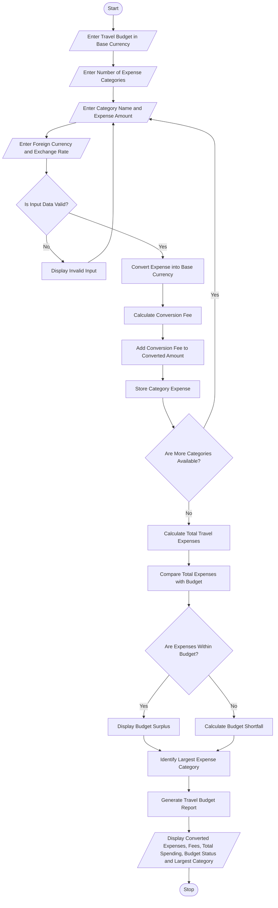

# Multi-Currency Travel Budget Analysis

print("===== TRAVEL BUDGET ANALYSIS =====")

budget = float(input("Enter your total travel budget (INR): "))
n = int(input("Enter number of expense categories: "))

expenses = []
total_spending = 0

for i in range(n):

    print("\nExpense", i + 1)

    category = input("Enter expense category: ")
    amount = float(input("Enter expense amount: "))
    currency = input("Enter currency (USD/EUR/GBP): ").upper()

    # Supplied exchange rates in INR
    rates = {
        "USD": 84,
        "EUR": 92,
        "GBP": 108
    }

    # Validate expense
    if amount < 0 or currency not in rates:
        print("Invalid amount or currency!")
        continue

    # Currency conversion
    converted = amount * rates[currency]

    # Conversion fee (2%)
    fee = converted * 0.02

    # Final expense in INR
    total = converted + fee

    total_spending += total

    expenses.append({
        "category": category,
        "amount": total
    })

    print("Converted Amount: Rs.", round(converted, 2))
    print("Conversion Fee: Rs.", round(fee, 2))
    print("Total Expense: Rs.", round(total, 2))

# Find largest expense category
print("\n===== TRAVEL EXPENSE REPORT =====")

for item in expenses:
    print(item["category"], ": Rs.", round(item["amount"], 2))

print("\nTotal Spending: Rs.", round(total_spending, 2))
print("Travel Budget: Rs.", budget)

# Budget comparison
if total_spending > budget:
    print("Status: Budget Exceeded!")
    print("Extra Amount: Rs.", round(total_spending - budget, 2))
else:
    print("Status: Within Budget!")
    print("Remaining Budget: Rs.", round(budget - total_spending, 2))

# Largest expense
if len(expenses) > 0:
    largest = max(expenses, key=lambda x: x["amount"])

    print("\nLargest Expense Category:", largest["category"])
    print("Amount: Rs.", round(largest["amount"], 2))
else:
    print("No valid expenses entered.")

 
